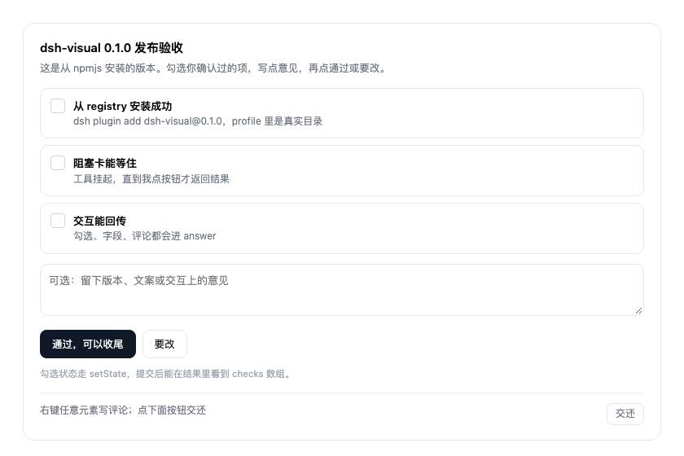

# dsh-visual

[](https://www.npmjs.com/package/dsh-visual)
[](https://www.npmjs.com/package/dsh-visual)
[](https://github.com/MjxUpUp/dsh-visual/actions/workflows/ci.yml)
[](LICENSE)
[](https://github.com/topics/dsh-plugin)

Interactive cards inside a DeepSeek Harness conversation. The model publishes a self-contained HTML card (or a draggable flowchart), the tool **blocks until the user submits**, and the user's click, comments, form fields and card state come back as the tool result.

No assistant text, no chat message, no artifact preview — a real card in the message stream.



## Features

- **Blocking, not fire-and-forget.** `visual` stays pending until the user submits, so the answer arrives as the tool result and the agent continues in the same turn.
- **Scriptable cards.** Inline `<script>` runs per card through a small bridge (`dshVisual.root`, `dshVisual.setState`), so cards can toggle, validate and prefill themselves.
- **Structured answers.** Buttons (`data-visual-action`), inputs (`data-visual-field`), comments and card state are merged into one JSON answer.
- **Comments with pins.** Right-click any element to leave a comment; the answer carries the element's selector and label so the model knows exactly what each note is about.
- **Flow editor.** Pass a `flow` graph instead of HTML: drag nodes, double-click to rename, connect, delete, then hand the edited graph back.
- **Parallel safe.** Several cards in one turn each get their own bridge and state; nothing leaks between them.
- **Cancellable and time-bounded.** `timeoutMs` and a stop button turn the card read-only instead of hanging forever.

## Requirements

- DeepSeek Harness 0.1.0-rc.1 and newer, below 0.3 (prerelease builds included)
- Node.js 20 or newer

## Install

```bash
dsh plugin --profile desktop add dsh-visual
```

Restart DeepSeek Harness once so the host half loads. After that, changes to `lib/client.js` only need a page refresh (⌘R).

For local development, link the directory instead:

```bash
dsh plugin --profile desktop add /path/to/dsh-visual
dsh plugin --profile desktop remove dsh-visual   # uninstall
```

## Quick start

Ask for a card in plain language:

> 用 visual 发一张发布确认卡，让我选版本并留一句备注

The model calls the tool roughly like this:

```json
{
  "title": "发布确认",
  "height": 360,
  "html": "<h3>发 0.1.1 到 npm？</h3><textarea data-visual-field=\"note\"></textarea><button data-visual-action=\"approve\">发</button><button data-visual-action=\"hold\">先别发</button>",
  "actions": [{ "id": "approve", "label": "发" }, { "id": "hold", "label": "先别发" }],
  "timeoutMs": 600000
}
```

When the user clicks, the tool returns one answer object:

```json
{
  "action": "approve",
  "payload": { "fields": { "note": "记得打 tag" } },
  "state": { "checks": ["install"] },
  "comments": [{ "selector": "h3", "label": "h3", "text": "标题再短一点" }]
}
```

## Parameters

| Parameter | Type | Description |
|---|---|---|
| `title` | string | Card header title. |
| `html` | string | Complete, self-contained HTML document. Styles are scoped; scripts run per card. |
| `flow` | object | Flow graph `{nodes, edges}` rendered as an editable canvas instead of HTML. |
| `data` | object | Initial state exposed as `dshVisual.data` to the card script. |
| `height` | number | Initial card height in px (160–900). The card can resize itself. |
| `actions` | array | Action registry `{id, label}` for the footer chips and button labels. |
| `timeoutMs` | number | How long to wait for a submit (default 10 min, max 1 h). |

Every field is optional except one of `html` or `flow`.

## Card protocol

### Buttons and fields

- `data-visual-action="id"` — clicking submits that action together with the fields, state and comments.
- `data-visual-field="name"` — read from the card on submit and returned under `answer.payload.fields`.
- The footer always shows a neutral **交还** button (`answer.action = "done"`). It never implies approval: review cards should carry an explicit approve/revise action of their own.

### Scripts and state

```html
<script>
(function (dshVisual) {
  var state = Object.assign({ on: false }, dshVisual.data || {})
  dshVisual.root.querySelector('.toggle').addEventListener('click', function () {
    state.on = !state.on
    this.textContent = state.on ? '开' : '关'
    dshVisual.setState(state)   // returned as answer.state
  })
})(dshVisual)
</script>
```

Each card is compiled as `new Function('dshVisual', source)(bridge)`, so parallel cards cannot see each other's state.

### Comments

Right-click any element inside the card, type a note, and it is pinned with a number. The answer carries them in `answer.comments` as `{ selector, label, text }`.

### Timeout and cancel

When `timeoutMs` elapses the call returns `action: "timeout"`; stopping the turn returns `action: "cancelled"`. In both cases the card becomes read-only and its footer explains why.

## Development

```bash
npm run check        # syntax of both entries + docs/code consistency guard
npm pack --dry-run   # inspect the published file list
```

The client half is a hand-written module-loader bundle, so no build step is required.

## Releasing

Publishing is automatic: pushing a `v*` tag runs the release workflow, which verifies `npm run check`, publishes to npm with provenance, and opens a GitHub Release.

```bash
npm version patch   # or minor / major
git push --follow-tags
```

Publishing uses npm [trusted publishing](https://docs.npmjs.com/trusted-publishers/): the workflow exchanges the GitHub OIDC token for a short-lived npm credential, so no `NPM_TOKEN` secret is stored. Configure it once under the package's **Settings → Trusted publishing** on npmjs.com (owner `MjxUpUp`, repository `dsh-visual`, workflow `publish.yml`).

## License

[MIT](LICENSE) © MjxUpUp
